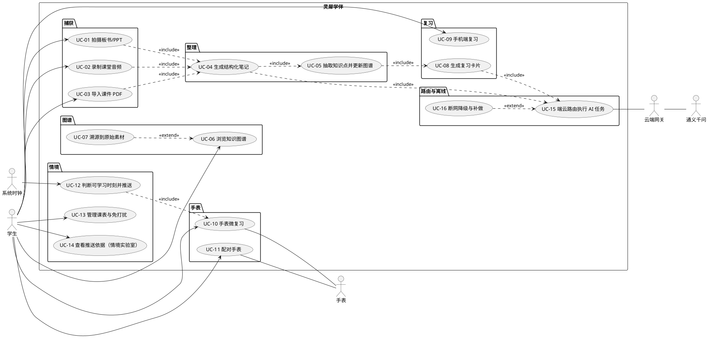

# 02 用例模型

- 文档编号：LX-REQ-02
- 版本：v0.1
- 日期：2026-11-19
- 所属阶段：需求分析 1.2
- 上游：[01 产品愿景与用户分析](01-vision.md)

## 1. 参与者

| 参与者 | 类型 | 说明 |
| --- | --- | --- |
| 学生 | 主参与者 | 使用手机和手表的唯一人类用户 |
| 手表 | 次参与者（设备） | Wear OS 手表，或华为 GT 5 等轻穿戴手表；展示卡片、采集作答与心率 |
| 云端网关 | 次参与者（系统） | 托管通义千问 API Key，提供知识抽取、卡片生成、中继 |
| 通义千问 | 次参与者（外部系统） | 云端大模型 |
| 系统时钟 | 次参与者（定时触发） | 驱动情境评估和到期复习检查 |

## 2. 用例图

## 3. 用例清单

| 编号 | 名称 | 主参与者 | 优先级（初赛） | 关联创新点 |
| --- | --- | --- | --- | --- |
| UC-01 | 拍摄板书/PPT | 学生 | Must | I2 |
| UC-02 | 录制课堂音频 | 学生 | Must | I2、I3 |
| UC-03 | 导入课件 PDF | 学生 | Could | I2 |
| UC-04 | 生成结构化笔记 | 系统 | Must | I2、I3 |
| UC-05 | 抽取知识点并更新图谱 | 系统 | Must | I2 |
| UC-06 | 浏览知识图谱 | 学生 | Must | I2 |
| UC-07 | 溯源到原始素材 | 学生 | Should | I2 |
| UC-08 | 生成复习卡片 | 系统 | Must | I2 |
| UC-09 | 手机端复习 | 学生 | Must | I5 |
| UC-10 | 手表微复习 | 学生 | Must | I1、I4 |
| UC-11 | 配对手表 | 学生 | Must | I4 |
| UC-12 | 判断可学习时刻并推送 | 系统时钟 | Must | I1 |
| UC-13 | 管理课表与免打扰 | 学生 | Must | I1 |
| UC-14 | 查看推送依据 | 学生 | Should | I1 |
| UC-15 | 端云路由执行 AI 任务 | 系统 | Must | I3 |
| UC-16 | 断网降级与补做 | 系统 | Should | I3 |

## 4. 用例详述

每个用例的「主流程 / 异常流程」直接转化为 SRS 中的功能需求和测试用例。

### UC-01 拍摄板书/PPT

- **前置条件**：已创建至少一门课程；已授予相机权限。
- **主流程**：
  1. 学生在「捕获」页点击拍照，系统根据课表预选当前课程。
  2. 学生拍摄一张或多张照片，系统自动检测文档边缘并做透视矫正。
  3. 学生确认后，系统保存原图与矫正图，在端侧执行 OCR（经 UC-15 路由）。
  4. 系统触发 UC-04，界面显示「整理中」。
- **异常流程**：
  - 2a 未检测到文档边缘：允许手动框选，或直接使用原图。
  - 3a 端侧 OCR 置信度低于阈值：经路由改由云端 OCR，并提示「已使用云端识别」。
  - 3b 相册导入：从相册选择图片，从第 2 步继续。
- **后置条件**：素材与识别文本已持久化，关联到课程。

### UC-02 录制课堂音频

- **前置条件**：已授予麦克风权限。
- **主流程**：
  1. 学生开始录音，系统在前台服务中录制并显示时长。
  2. 学生停止录音，系统保存音频，在端侧离线转写（sherpa-onnx）。
  3. 系统触发 UC-04。
- **异常流程**：
  - 1a 录音中来电或切到后台：继续录制，通知栏可停止。
  - 2a 存储空间不足：提示并停止录音，已录部分保留。
- **隐私约束**：音频原文件默认只在本地处理，不上传云端；只上传转写文本，且在设置中可关闭。

### UC-04 生成结构化笔记

- **前置条件**：存在识别文本（OCR 和/或转写）。
- **主流程**：
  1. 系统合并同一课次的识别文本，构造「知识抽取」任务。
  2. 经 UC-15 路由到云端网关 `/v1/extract`，调用通义千问。
  3. 网关按 JSON Schema 校验输出，返回结构化笔记 Markdown、知识点、关系。
  4. 系统保存笔记并触发 UC-05。
- **异常流程**：
  - 3a 输出不符合 Schema：网关自动重试一次；仍失败则返回错误码，笔记标记为「待整理」。
  - 2a 无网络：转入 UC-16。

### UC-05 抽取知识点并更新图谱

- **主流程**：
  1. 对每个新知识点，按名称归一化与语义相似度查找已有节点。
  2. 相似度高于阈值则合并（追加来源笔记），否则新建节点。
  3. 写入关系边，丢弃自环和指向不存在节点的边。
  4. 触发 UC-08 为新知识点生成卡片。
- **异常流程**：3a 关系会形成先修环：保留置信度高的边，记录冲突日志。

### UC-06 浏览知识图谱 / UC-07 溯源

- **主流程**：学生打开「图谱」页，按课程筛选；节点颜色表示掌握程度（来自记忆状态）；点击节点查看摘要、相关卡片；点击「来源」跳转到原始照片、录音片段或 PDF 页（UC-07）。
- **异常流程**：节点超过 200 个时默认只显示当前课程和一跳邻居。

### UC-08 生成复习卡片

- **主流程**：系统为新知识点调用网关生成 2–3 张卡片（至少一张适合手表的判断或单选题），初始化记忆状态。
- **异常流程**：生成失败的知识点进入重试队列，下次联网时补做。

### UC-09 手机端复习

- **主流程**：学生打开「复习」页，系统列出到期卡片（每日上限可设）；学生看题、翻面、自评（重来/困难/良好/简单）；系统用 FSRS 更新记忆状态和下次复习时间，写复习日志。
- **异常流程**：今日无到期卡片时提示，并可选择「提前复习薄弱知识点」。

### UC-10 手表微复习

- **前置条件**：手表已配对（UC-11）；存在适合手表的到期卡片。
- **主流程**：
  1. UC-12 判定可学习时刻后，手机选取 1–3 张卡片，经 `WatchLink` 推送到手表。
  2. 手表轻震，显示题目和推送依据摘要。
  3. 学生作答，手表把结果和反应时长回传手机。
  4. 手机更新记忆状态，记录推送反馈（已作答）。
- **异常流程**：
  - 2a 学生 30 秒内未抬腕或划掉：记录为「忽略」反馈，计入情境引擎校准数据。
  - 3a 链路中断：手表本地暂存作答，恢复连接后补发；手机按消息 id 去重。
  - 1a 手表为华为 GT 5 且无 Wear Engine 权限：降级为手机通知镜像，只展示题目和答案，不回传作答。

### UC-11 配对手表

- **主流程**：手机显示 6 位配对码，手表输入或扫码后，双方通过网关中继建立会话；系统探测可用链路（Wear Data Layer、中继、Wear Engine、通知镜像），按优先级选主链路和备链路。
- **异常流程**：配对码 5 分钟过期；网关不可达时提示检查网络。

### UC-12 判断可学习时刻并推送

- **前置条件**：已开启情境推送；当日推送次数未达上限。
- **主流程**：
  1. 系统时钟每 5 分钟（或活动状态变化时）触发评估。
  2. 收集信号：课表、活动状态、心率、前台应用类别、电量、上次推送时间。
  3. `LearnableMomentDetector` 先执行硬性阻止规则，再证据加权打分，输出是否可学、建议卡片数、依据列表。
  4. 可学则触发 UC-10，并保存评估记录。
- **异常流程**：3a 命中硬性阻止（上课中、运动中、免打扰时段）：不推送，记录原因。

### UC-13 管理课表与免打扰

- **主流程**：学生录入课程（名称、时间、地点、周次）或导入课表文件；设置免打扰时段和每日推送上限。

### UC-14 查看推送依据（情境实验室）

- **主流程**：学生在情境实验室查看最近的评估记录与每条依据的权重；演示模式下可手动调节信号，实时看到判断结果变化。

### UC-15 端云路由执行 AI 任务

- **主流程**：业务调用 `InferenceRouter`；路由策略根据任务类型、隐私等级、网络、电量、发热决定端侧或云端；执行失败按策略切换另一侧；返回结果并附「执行位置与原因」。
- **异常流程**：两侧都不可用时返回「不可用」及原因，交给 UC-16。

### UC-16 断网降级与补做

- **主流程**：只能上云的任务进入持久化待办队列；界面显示「联网后自动整理」；网络恢复后按先进先出补做并通知学生。

## 5. 用例与问题、创新点追溯

| 问题 | 用例 |
| --- | --- |
| P1 课堂素材难以变成知识 | UC-01 至 UC-05 |
| P2 没有整块时间 | UC-10、UC-12 |
| P3 不知道复习什么 | UC-06、UC-08、UC-09 |
| P4 推送时机不对 | UC-12、UC-13、UC-14 |
| P5 隐私顾虑 | UC-02、UC-15 |
| P6 手表生态分散 | UC-10、UC-11 |
