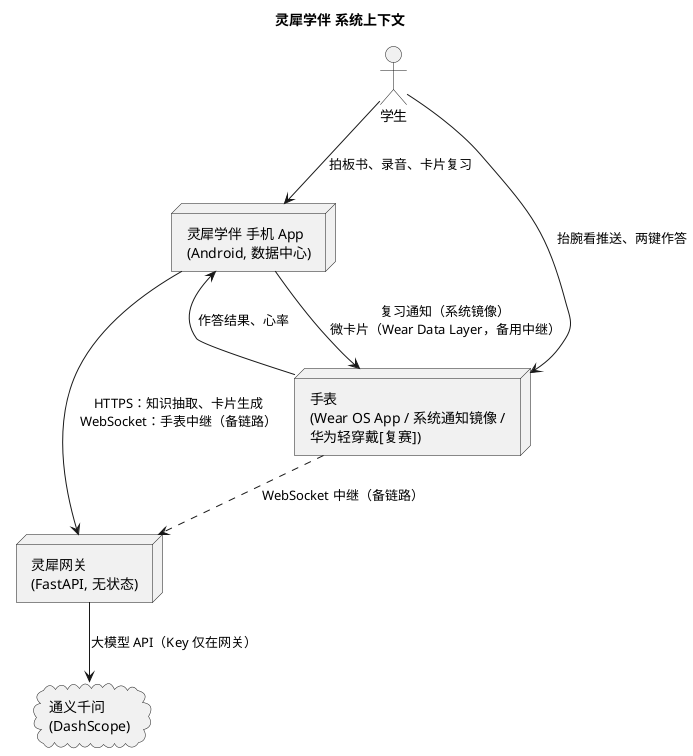
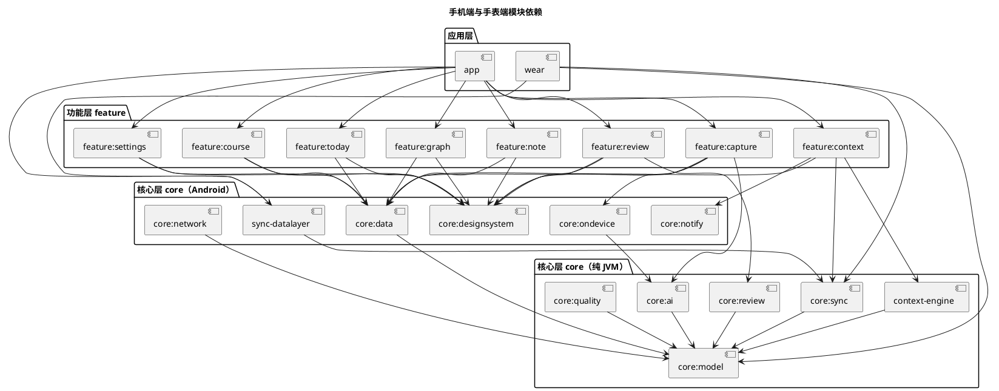
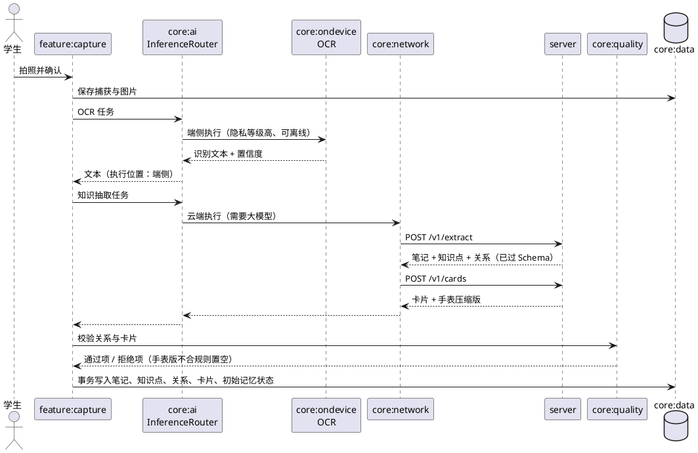

# 01 总体架构设计

- 文档编号：LX-DES-01
- 版本：v0.1（待评审）
- 日期：2026-11-21
- 所属阶段：系统设计 2.1
- 上游：[03 SRS v0.2](../01-requirements/03-srs.md)、[卡片式复习交互调研](card-review-ux.md)

## 1. 设计目标与原则

| 编号 | 原则 | 来源需求 |
| --- | --- | --- |
| D1 | **手机优先、手机是数据中心**：全部用户数据存在手机本地数据库，网关无状态 | SRS 2.1、NFR-SEC-02 |
| D2 | **算法与界面分离**：不依赖 Android 的逻辑放 JVM 模块，脱离 SDK 可测 | C4、NFR-MAINT-01 |
| D3 | **依赖单向**：`app / wear → feature → core`，`core` 之间只依赖 `core:model` | CLAUDE.md |
| D4 | **AI 调用唯一入口**：业务只通过 `InferenceRouter`，执行位置可解释 | C3、FR-AI-01 至 05 |
| D5 | **Google 依赖可替换**：手表同步初赛用 Wear Data Layer，但只通过 `WatchLink` 抽象使用，并隔离在独立模块；无 Play 服务时自动切到网关中继 | C1、FR-SYNC-02、ADR 0007 |
| D6 | **离线优先**：只能上云的任务进入持久化待办队列，联网补做 | FR-AI-05、NFR-AVAIL-01 |
| D7 | **可追溯**：每个组件标注所实现的需求编号 | 开发规范 |

## 2. 系统上下文（C4 第 1 层）

## 3. 容器视图（C4 第 2 层）

| 容器 | 技术 | 职责 | 数据 |
| --- | --- | --- | --- |
| 手机 App | Kotlin、Jetpack Compose、Room、WorkManager、CameraX、ONNX Runtime、sherpa-onnx | 捕获、端侧识别、卡片式复习、图谱、情境评估、推送、手表协调 | Room 数据库 + 素材文件（应用私有目录） |
| Wear OS App | Kotlin、Wear Compose、Tiles、Wear Data Layer | 微卡片展示与两键作答、磁贴「今日待复习」、心率采集 | 仅缓存未回传的作答 |
| 系统通知镜像 | Android 通知 + 手表厂商同步 | 任何手表显示复习通知 | 无 |
| 灵犀网关 | Python 3.12、FastAPI、httpx、pydantic | 抽取、出题、答疑代理；设备鉴权、限流；手表中继（Data Layer 不可用时的备链路） | 无持久用户数据，只有调用计数与脱敏日志 |
| 通义千问 | DashScope OpenAI 兼容接口 | 大模型推理 | 外部 |

## 4. 模块视图（C4 第 3 层，Gradle 模块）

### 4.1 模块职责

| 模块 | 类型 | 状态 | 职责 | 实现的需求 |
| --- | --- | --- | --- | --- |
| `core:model` | JVM | 已有，需扩展 | 领域模型：课程、捕获、笔记、知识点、关系、卡片（新增 `watchPrompt`、`watchAnswer`、`sourceRef`、挖空题型）、记忆状态、复习日志；知识抽取结果 `Extraction` 等跨模块共享类型 | 全部 |
| `core:review` | JVM | 已有，需扩展 | FSRS 调度；四档下次间隔预测；每日队列与上限；短组与组内回炉；图谱感知排序；考前模式 | FR-REV-02、03、07、14、15、16 |
| `core:quality` | JVM | **新增** | 卡片与手表版本的规则校验（长度、答案唯一、干扰项、相关性）；知识关系校验（自环、端点、先修环） | FR-REV-10、FR-WEAR-08、FR-KG-03 |
| `core:ai` | JVM | 已有 | 任务分类、路由策略、`InferenceRouter`、失败切换、执行记录 | FR-AI-01 至 04 |
| `core:sync` | JVM | 已有，需扩展 | `WatchLink` 抽象、消息协议（版本、id、ACK、重传）、主备切换、中继客户端；中继模式的配对与加密 | FR-SYNC-01 至 04 |
| `sync-datalayer` | Android | **新增** | `DataLayerWatchLink`：基于 Wear Data Layer 的主链路，手机与手表共用；唯一依赖 Play 服务的模块 | FR-SYNC-02、ADR 0007 |
| `context-engine` | JVM | 已有，需扩展 | 可学习时刻判断；打扰预算；静音时段；依据生成 | FR-CTX-02、03、08、09 |
| `core:data` | Android | **新增** | Room 数据库、DAO、仓库层、文件存储、待办任务队列 | 5 节数据需求、FR-AI-05 |
| `core:network` | Android | **新增** | 网关客户端（OkHttp）：鉴权令牌、超时重试、错误映射；云端 `ModelBackend` 实现 | FR-GW-*、FR-AI-03 |
| `core:ondevice` | Android | **新增** | 端侧 `ModelBackend`：PaddleOCR（ONNX Runtime）、sherpa-onnx 转写；模型文件加载 | FR-NOTE-01、02 |
| `core:notify` | Android | **新增** | 复习通知（两键操作、进入碎片模式）、通知渠道、前台录音服务通知 | FR-WEAR-05、FR-REV-12 |
| `core:designsystem` | Android | **新增** | 主题、配色、字号、卡片组件、翻面动画 | NFR-UX |
| `feature:today` | Android | **新增** | 「今日」首页：任务量、预计用时、连续天数、热力图 | FR-REV-08、09 |
| `feature:review` | Android | **新增**（取代原 `ReviewScreen`） | 卡片页：翻面、三键与手势、自动判分、撤销、组末小结、纠错 | FR-REV-04、07、13、14 |
| `feature:capture` | Android | **新增**（取代原 `CaptureScreen`） | 拍照、相册导入、矫正、录音 | FR-CAP-* |
| `feature:note` | Android | **新增** | 笔记列表与详情、编辑、溯源 | FR-NOTE-03 至 06 |
| `feature:graph` | Android | **新增**（取代原 `GraphScreen`） | 图谱可视化、节点详情、记忆着色 | FR-KG-04 至 06 |
| `feature:course` | Android | **新增** | 课程与课表管理 | FR-COURSE-* |
| `feature:context` | Android | **新增**（取代原 `ContextLabScreen`） | 信号采集（WorkManager 定时 + 活动识别 + 课表）、推送决策、情境实验室 | FR-CTX-01、04 至 06 |
| `feature:settings` | Android | **新增** | 隐私、推送、数据导出、首次引导、手表配对 | FR-SET-*、FR-SYNC-01 |
| `app` | Android | 已有，需瘦身 | 导航、依赖注入装配、`Application` | — |
| `wear` | Wear OS | 已有，需扩展 | 微卡片、两键作答、磁贴、作答缓存与补发 | FR-WEAR-01 至 04、07 |
| `server` | Python | 已有，需扩展 | `/v1/extract`、`/v1/cards`（含手表压缩版）、`/v1/chat`、`/v1/relay`、鉴权限流、提示词版本 | FR-GW-* |

依赖注入：使用 Hilt 以外的轻量方案（手写 `AppContainer`），避免引入注解处理带来的构建复杂度；详见 ADR 0004（待写）。

## 5. 关键运行时场景

### 5.1 拍板书到卡片（I2）

断网时：知识抽取路由返回「不可用」，`core:data` 写入待办任务，WorkManager 在联网约束满足时重试（FR-AI-05）。

### 5.2 卡片式复习（I3）

`feature:review` 从 `core:review` 取今日队列 → 展示一张卡片 → 翻面时调用 `predictIntervals()` 在三键上显示间隔 → 自评后 `schedule()` 产生新记忆状态 → 同一事务写入记忆状态与复习日志 → 取下一张；组末展示小结。

### 5.3 情境推送到手表（I5）

WorkManager 每 15 分钟（系统最小周期）+ 活动识别变化时触发 → `feature:context` 汇总信号 → `context-engine` 先查静音时段与打扰预算，再打分 → 可学则选 1 张有手表版本的到期卡 → `core:notify` 发带两键的通知（手表自动镜像）；若已配对 Wear OS 手表，同时经 `WatchLink`（Data Layer 主链路，中继备链路）推微卡片 → 作答经通知按钮或手表回传，写入记忆状态；忽略只记推送反馈，不写 FSRS。

> 说明：WorkManager 周期任务最短 15 分钟，SRS v0.3 已据此修改 FR-CTX-04。

## 6. 部署视图

| 阶段 | 手机 | 手表 | 网关 |
| --- | --- | --- | --- |
| 开发与初赛 | Mac 上 Android 模拟器（API 36，带 Play 服务） | Mac 上 Wear OS 模拟器，经 Data Layer 与手机配对 | Mac 本机 `uvicorn`，模拟器经 `10.0.2.2` 访问 |
| 决赛 | 真机（届时与组委会确认是否有 Google 服务） | 组委会 OPPO 手表或自备 Wear OS 手表；无 Play 服务时切到中继；华为 GT 5 走通知镜像 | 云服务器或现场笔记本，局域网可达 |

## 7. 横切关注点

| 关注点 | 方案 |
| --- | --- |
| 隐私 | 音频不出手机；上传前按隐私设置过滤；网关日志只记任务类型、耗时、结果码 |
| 安全 | 设备令牌鉴权；中继消息端到端加密（配对时 X25519 协商，复赛前完成）；API Key 只在 `server/.env` |
| 错误处理 | 统一 `Result` 类型；网关错误码映射为用户可读原因 |
| 日志与可观测 | 手机端 AI 执行记录入库可查看；网关结构化日志 |
| 性能 | 端侧模型懒加载；图谱超过 200 节点按课程分片 |
| 可测试性 | JVM 模块单测；Room 用内存数据库测试；网关用录制响应，不重复调用大模型 |

## 8. 与现有代码的差距与迁移

1. `app` 中 5 个原型页面迁入对应 `feature:*` 模块，`SampleData` 只保留给预览。
2. `ReviewCard` 增加字段与 `CardType.CLOZE`，`Rating` 不变。
3. 新建 `core:data`、`core:network`、`core:ondevice`、`core:notify`、`core:quality`、`core:designsystem`、`sync-datalayer`。
4. `docs/architecture.md` 精简为指向本文档的摘要。
5. `Extraction`、`ExtractedPoint`、`ScoredEdge` 等类型放在 `core:model`：网关客户端、质量校验与仓库层都要使用，放在其他 core 模块会造成 core 模块之间互相依赖。

## 9. 待决策（将形成 ADR）

| ADR | 主题 | 倾向 |
| --- | --- | --- |
| 0003 | 端侧 OCR 方案 | PaddleOCR PP-OCRv4 mobile 转 ONNX + ONNX Runtime Android |
| 0004 | 依赖注入 | 手写 `AppContainer`，不引入 Hilt |
| 0005 | 图谱渲染 | Compose Canvas 自绘力导向布局（无合适的开源 Compose 图谱库） |
| 0006 | 本地数据库 | Room + KSP |
| 0007 | 手表通信 | 已采纳：初赛用 Wear Data Layer（独立模块），中继备用，通知为推送入口 |
