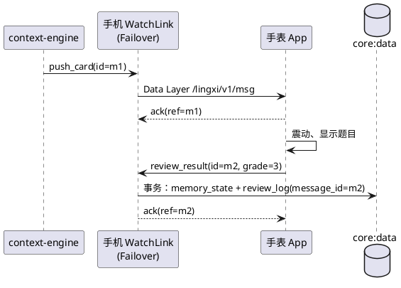

# 04 接口设计

- 文档编号：LX-DES-04
- 版本：v0.1（待评审）
- 日期：2026-11-21
- 所属阶段：系统设计 2.4
- 上游：[01 总体架构](01-architecture.md)、[03 数据库](03-database.md)、[ADR 0007](../adr/0007-watch-communication.md)

本文档定义三类接口：手机与网关之间的 REST 接口、手机与手表之间的消息协议、网关与大模型之间的提示词与输出 Schema。
网关的机器可读接口由 FastAPI 自动生成，`scripts/export_openapi.py` 导出到 `server/openapi.json` 并纳入版本库，接口变更在 PR 中可见。

## 1. 网关 REST 接口

### 1.1 通用约定

| 项 | 约定 |
| --- | --- |
| 基础地址 | 开发：`http://10.0.2.2:8000`（模拟器访问 Mac）；决赛：部署地址 |
| 版本 | 路径前缀 `/v1`；不兼容变更升 `/v2` |
| 鉴权 | `Authorization: Bearer <设备令牌>`；WebSocket 用查询参数 `token` |
| 编码 | 请求与响应均为 `application/json; charset=utf-8`，字段 snake_case |
| 请求 id | 客户端可带 `X-Request-Id`，网关原样返回并写入日志，用于端到端排查 |
| 超时 | 客户端连接 5 秒、读取 30 秒（抽取与出题），失败由 `InferenceRouter` 决定是否切换 |
| 限流 | 每设备每分钟 20 次 AI 请求，超出返回 429 与 `Retry-After` |
| 提示词版本 | AI 接口响应头 `X-Prompt-Version`，同时写入响应体 `prompt_version` |
| 隐私 | 网关不落盘请求正文；日志只记路径、设备令牌哈希、耗时、状态码 |

### 1.2 错误响应

```json
{ "error": { "code": "LLM_INVALID_OUTPUT", "message": "大模型输出无法通过校验", "request_id": "c1f…" } }
```

| HTTP | code | 含义 | 客户端处理 |
| --- | --- | --- | --- |
| 400 | `BAD_REQUEST` | 参数非法 | 不重试，记录错误 |
| 401 | `UNAUTHORIZED` | 令牌无效 | 提示重新配置网关 |
| 413 | `TEXT_TOO_LONG` | 文本超长 | 客户端分段后重试 |
| 422 | `LLM_INVALID_OUTPUT` | 重试一次后输出仍不合规 | 笔记标记「待整理」，入待办队列 |
| 429 | `RATE_LIMITED` | 超过限流 | 按 `Retry-After` 退避 |
| 502 | `LLM_UPSTREAM` | 大模型服务错误或超时 | 入待办队列，指数退避 |
| 503 | `LLM_NOT_CONFIGURED` | 网关未配置 API Key | 提示「云端功能未启用」 |

### 1.3 接口清单

| 方法 | 路径 | 用途 | 需求 | 状态 |
| --- | --- | --- | --- | --- |
| GET | `/health` | 健康检查，返回版本与大模型是否已配置 | — | 已有，需扩展 |
| POST | `/v1/extract` | 识别文本 → 结构化笔记 + 知识点 + 关系 | FR-NOTE-03、FR-KG-01、FR-GW-01 | 已有，需扩展笔记字段 |
| POST | `/v1/cards` | 知识点 → 卡片（含手表压缩版） | FR-REV-01、10、11，FR-WEAR-08，FR-GW-02 | 新增 |
| POST | `/v1/chat` | 围绕笔记的答疑 | FR-GW-03 | 已有 |
| POST | `/v1/ocr` | 端侧 OCR 置信度不足时的云端识别（需用户允许上传图片） | FR-NOTE-01 异常流程 | 新增（Should） |
| WS | `/v1/relay/{pair_code}/{role}` | 手表中继（Data Layer 不可用时的备链路） | FR-GW-04、FR-SYNC-02 | 已有 |

### 1.4 POST /v1/extract

请求：

```json
{
  "course_name": "高等数学",
  "lesson_id": "0b6f…",
  "segments": [
    { "source_id": "cap-1", "kind": "OCR", "text": "泰勒公式 f(x)=f(a)+f'(a)(x-a)+…", "page": 1 },
    { "source_id": "cap-2", "kind": "ASR", "text": "今天我们讲泰勒展开……", "start_ms": 0, "end_ms": 300000 }
  ],
  "existing_titles": ["导数", "极限"]
}
```

- `segments` 总字符数 ≤ 30,000；`existing_titles` 让模型复用已有知识点名称，减少重复节点（FR-KG-02）。

响应 200：

```json
{
  "note": { "title": "泰勒展开", "markdown": "## 要点\n- …", "key_points": [ { "text": "…", "source_ids": ["cap-1"] } ] },
  "points": [ { "id": "taylor-expansion", "title": "泰勒展开", "summary": "用多项式逼近函数……", "source_ids": ["cap-1", "cap-2"] } ],
  "edges": [ { "from": "derivative", "to": "taylor-expansion", "relation": "PREREQUISITE", "confidence": 0.9 } ],
  "prompt_version": "extract-v2",
  "model": "qwen-plus",
  "latency_ms": 4210
}
```

服务端校验（现有 `parse_extraction` 扩展）：知识点 3–12 个、标题 ≤ 40 字、摘要 ≤ 200 字、id 去重、边端点必须存在、去自环、`confidence` ∈ [0,1]；`source_ids` 必须是请求中出现过的 id。

### 1.5 POST /v1/cards

请求：

```json
{
  "course_name": "高等数学",
  "points": [ { "id": "taylor-expansion", "title": "泰勒展开", "summary": "…", "context": "笔记中相关段落" } ],
  "per_point": 3,
  "types": ["CLOZE", "TRUE_FALSE", "SINGLE_CHOICE", "QUESTION_ANSWER"],
  "require_watch_variant": true
}
```

响应 200：

```json
{
  "cards": [
    {
      "point_id": "taylor-expansion",
      "type": "TRUE_FALSE",
      "question": "函数在某点可导，就一定能在该点做任意阶泰勒展开。",
      "answer": "错误。需要函数在该点具有相应阶数的导数。",
      "options": null,
      "watch_prompt": "可导就能任意阶泰勒展开？",
      "watch_answer": "错，需高阶可导"
    }
  ],
  "rejected": [ { "point_id": "…", "reason": "WATCH_PROMPT_TOO_LONG" } ],
  "prompt_version": "cards-v1"
}
```

服务端规则（与 `core:quality` 同一套规则，两端各校验一次）：

| 规则 | 不通过时 |
| --- | --- |
| 每个知识点至少 1 张 `TRUE_FALSE` 或 `SINGLE_CHOICE` | 重试一次，仍缺则在 `rejected` 说明 |
| `question` ≤ 120 字，`answer` ≤ 200 字 | 丢弃该卡 |
| 单选：2–4 个选项、恰好 1 个正确、选项互不相同 | 丢弃该卡 |
| 挖空：`question` 含且仅含一个 `{{c1::…}}` | 丢弃该卡 |
| `watch_prompt` ≤ 20 字、`watch_answer` ≤ 12 字 | 置空手表版本，卡片保留 |

### 1.6 GET /health

```json
{ "status": "ok", "version": "0.2.0", "llm_configured": true, "model": "qwen-plus" }
```

## 2. 手机与手表消息协议

### 2.1 传输映射

| 链路 | 手机 → 手表 | 手表 → 手机 | 说明 |
| --- | --- | --- | --- |
| Wear Data Layer（主） | `MessageClient` 路径 `/lingxi/v1/msg`；今日待复习数用 `DataClient` 数据项 `/lingxi/v1/today` | `MessageClient` 路径 `/lingxi/v1/msg` | 消息体是同一份 JSON（UTF-8 字节） |
| 网关中继（备） | WebSocket 文本帧 | WebSocket 文本帧 | 已实现，见 `RelayWatchLink` |

链路差异只在 `sync-datalayer` 与 `core:sync` 的 `WatchLink` 实现内部处理，业务只见 `WatchMessage`。

### 2.2 消息封装

现有 `WatchMessage` 增加协议版本与 ACK，向后兼容（新增字段都有默认值）：

```json
{ "type": "push_card", "v": 1, "id": "m-7f3a", "sent_at": 1795101234000, … }
```

| 字段 | 说明 |
| --- | --- |
| `type` | 消息类型（kotlinx.serialization 多态判别字段） |
| `v` | 协议版本，当前 1；收到更高版本时只处理认识的字段 |
| `id` | 消息唯一 id，接收端按 id 去重（主备链路同时送达也只处理一次） |
| `sent_at` | 发送时间（UTC 毫秒） |

### 2.3 消息类型

| type | 方向 | 字段 | 需求 | 状态 |
| --- | --- | --- | --- | --- |
| `push_card` | 手机 → 手表 | `card_id`、`kind`（TRUE_FALSE / CHOICE2 / RECALL）、`prompt`（≤ 20 字）、`options`（二选一时 2 项）、`answer`（≤ 12 字）、`correct_index`、`reason`（推送依据一行）、`course` | FR-WEAR-01、02、08 | 已有，按小屏规范调整字段 |
| `review_result` | 手表 → 手机 | `card_id`、`grade`（只会是 1 或 3）、`answered_at`、`response_ms`、`push_id` | FR-WEAR-03 | 已有，增加 `push_id` |
| `push_dismissed` | 手表 → 手机 | `card_id`、`push_id`、`action`（DISMISS / SNOOZE） | FR-CTX-05、FR-WEAR-08（不写 FSRS） | 新增 |
| `ack` | 双向 | `ref_id`（被确认的消息 id） | FR-SYNC-03 | 新增 |
| `today_summary` | 手机 → 手表 | `due_count`、`streak_days` | 磁贴 | 新增 |
| `context_signal` | 手表 → 手机 | `heart_rate_bpm`、`steps_last_minute`、`on_wrist` | FR-WEAR-07 | 已有 |

### 2.4 可靠性

- 需要确认的消息：`push_card`、`review_result`、`push_dismissed`。发送方 3 秒内未收到 `ack` 则重传，最多 3 次；仍失败时手表把作答写入本地队列，链路恢复后补发（FR-WEAR-04）。
- 手机端以 `review_log.message_id` 唯一约束兜底去重。
- `FailoverWatchLink` 主链路发送失败或 5 秒无 `ack` 时切到备链路（FR-SYNC-02）。

### 2.5 时序：一次手表作答



## 3. 大模型提示词与输出 Schema

| 提示词 | 版本 | 输入 | 输出 Schema | 温度 |
| --- | --- | --- | --- | --- |
| 知识抽取 | `extract-v2` | 课程名、带来源 id 的文本段、已有知识点名 | 1.4 节响应体（不含 model、latency） | 0.2 |
| 卡片生成 | `cards-v1` | 课程名、知识点及上下文、题型、每点数量 | 1.5 节 `cards` 数组 | 0.5 |
| 答疑 | `chat-v1` | 笔记、问题 | 纯文本 + 引用的知识点 id | 0.3 |

- 提示词以文件保存在 `server/app/prompts/<名称>-<版本>.md`，版本号写在文件名里，修改即升版（FR-GW-06）。
- 调用通义千问时开启 JSON 输出模式（`response_format: {"type": "json_object"}`），再用 pydantic 严格校验；不合规重试一次，仍失败返回 422。
- 回归测试：`server/tests/fixtures/` 保存录制的模型响应，测试不调用真实接口；另有手动评测脚本对自建 10 节课样本跑抽取并人工评分（FR-KG-01 验收）。

## 4. 手机端内部接口（关键）

以下为模块之间的 Kotlin 接口，签名在 2.7 代码对齐阶段落地。

| 接口 | 模块 | 方法 | 说明 |
| --- | --- | --- | --- |
| `GatewayApi` | core:network | `extract(req)`、`generateCards(req)`、`health()` | 返回 `Result`，错误映射为 `GatewayError` |
| `ModelBackend` | core:ai | `run(task)` | 已有；新增云端实现 `GatewayBackend`、端侧实现 `OcrBackend`、`AsrBackend` |
| `CardRepository` | core:data | `dueQueue(day, cap)`、`saveReview(cardId, rating, log)`、`undo(logId)` | 自评与日志同一事务 |
| `KnowledgeRepository` | core:data | `mergeExtraction(lessonId, extraction)`、`graph(courseId)`、`prerequisites(kpId)` | 合并去重在事务内完成 |
| `Scheduler` | core:review | `schedule(state, rating, now)`、`predictIntervals(state, now)`、`buildQueue(...)` | 纯函数 |
| `CardValidator` | core:quality | `validate(card): List<Violation>`、`watchVariantOk(card)` | 规则与网关一致 |
| `PushPolicy` | context-engine | `allow(now, history, settings): Decision` | 打扰预算与静音时段 |
| `WatchLink` | core:sync | `send(msg)`、`incoming: Flow<WatchMessage>` | 已有 |
