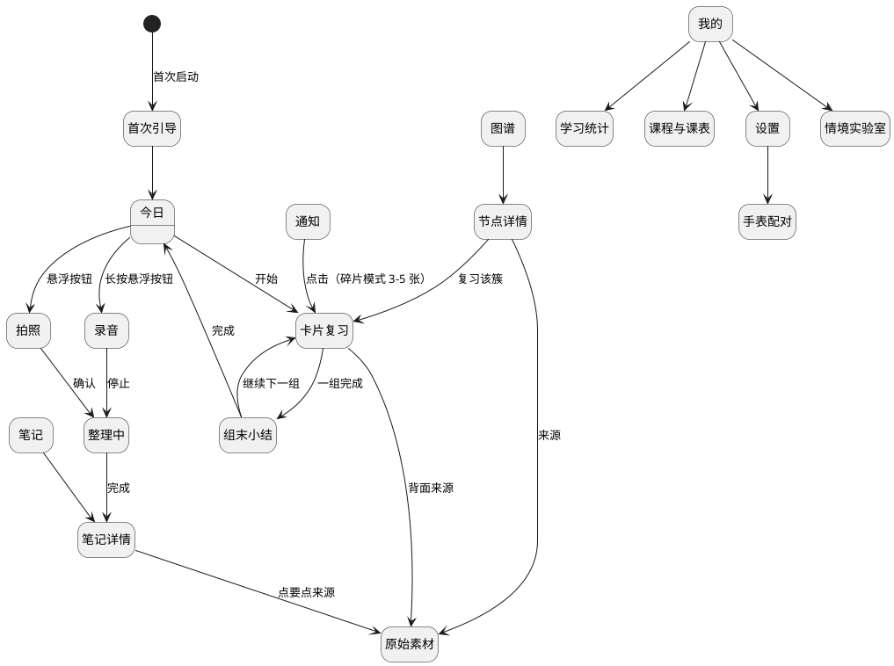

# 05 界面设计

- 文档编号：LX-DES-05
- 版本：v0.1（待评审）
- 日期：2026-11-21
- 所属阶段：系统设计 2.5
- 上游：[02 用例模型](../01-requirements/02-use-cases.md)、[卡片式复习交互调研](card-review-ux.md)

## 1. 信息架构

手机端底部导航 4 个一级入口，按「复习优先」排序；拍照是最高频动作，放在「今日」页的悬浮按钮，任何一级页面一步可达。

| 一级入口 | 作用 | 二级页面 |
| --- | --- | --- |
| 今日 | 每日任务与开始复习 | 卡片复习、组末小结、考前模式 |
| 笔记 | 按课程浏览课次笔记 | 笔记详情、原始素材查看、拍照 / 录音 |
| 图谱 | 知识图谱与掌握度 | 节点详情、该簇复习 |
| 我的 | 统计、课程、设置 | 学习统计、课程与课表、推送设置、隐私设置、手表、情境实验室、数据导出 |

## 2. 页面流转



## 3. 手机页面线框

### 3.1 今日（FR-REV-08、09）

```
┌──────────────────────────────┐
│ 11月21日 周六      🔥 连续 6 天 │
│                              │
│      ╭───────────╮           │
│      │  23 张    │  进度环    │
│      │  约 6 分钟 │           │
│      ╰───────────╯           │
│   新卡 10 · 复习 13          │
│                              │
│   [        开始复习        ] │
│                              │
│ 距期中 12 天 · 高数待巩固 34  │  考前模式（有考试日时显示）
│ ▢▢▣▣▣▢▣  本周热力图           │
│                         (📷) │  悬浮按钮：点拍照，长按录音
├──────────────────────────────┤
│  今日   笔记   图谱   我的     │
└──────────────────────────────┘
```

### 3.2 卡片复习（FR-REV-04、07、13、14）

正面与背面布局采用调研文档 2.1 节的设计，要点：

- 顶栏：课程 · 知识点、组内进度 `3/8`、撤销按钮。
- 正面只显示问题，提示「轻点翻面 · 先想一想」；判断题与单选题直接显示选项，点选即判分。
- 背面：答案、一句解释、**课堂来源**（「11月18日 板书 第3页 ▸」）、**图谱邻居**（前置、相关）。
- 底部三键：`忘了 10分` `模糊 1天` `记得 4天`，间隔由 `Scheduler.predictIntervals` 计算；上滑 = 太简单，左滑 = 忘了，右滑 = 记得。
- 右上角「纠错」：标记有误、编辑、删除（FR-REV-10）。

### 3.3 组末小结

```
┌──────────────────────────────┐
│        本组完成 ✓             │
│  8 张 · 1 分 52 秒 · 记得 6   │
│  巩固了：泰勒展开、麦克劳林…   │
│  高数掌握度 +4%               │
│  [ 再来一组 ]   [ 今天到这 ]   │
└──────────────────────────────┘
```

### 3.4 拍照与整理（FR-CAP-01 至 03、FR-NOTE-03）

```
┌──────────────────────────────┐
│ 高等数学 ▾（按课表预选）    ✕ │
│ ┌──────────────────────────┐ │
│ │      取景框 + 自动边框     │ │
│ └──────────────────────────┘ │
│  [相册]     ( ◉ )     [3 张▸] │
└──────────────────────────────┘
          ↓ 确认
┌──────────────────────────────┐
│ 正在整理                     │
│ ✓ 识别文字（手机本地，1.8 秒） │  执行位置与原因（FR-AI-04）
│ ◌ 整理笔记（云端，需要大模型） │
│ ○ 生成卡片                    │
│ 断网时：联网后自动整理         │
└──────────────────────────────┘
```

### 3.5 笔记详情（FR-NOTE-04、05）

标题、要点列表（每条右侧有来源角标，点开定位到照片框选区域或录音时间点）、公式渲染、底部「本节生成 12 张卡片 ▸」与「编辑」。

### 3.6 图谱（FR-KG-04 至 06）

- 全屏画布，力导向布局，双指缩放、拖动；顶部课程筛选。
- 节点颜色：绿（可提取性 ≥ 0.9）、黄（0.7–0.9）、红（< 0.7）、灰（未学）；先修边带箭头。
- 点节点弹出底部面板：摘要、来源、相关卡片数、`[复习这一簇]`。

### 3.7 情境实验室（FR-CTX-06，演示用）

- 上半：信号面板（课表状态、活动、心率、前台应用类别、电量、静音时段、今日已推次数），每项可手动调节。
- 下半：实时判断结果「可学习 · 建议 2 张」及依据列表（每条带权重条）；被阻止时显示原因（例如「静音时段 22:30–07:30」）。
- 预设场景按钮：排队、通勤、上课、跑步、深夜。

### 3.8 设置（FR-SET-01 至 04）

推送（开关、每日上限、最小间隔、静音时段）、隐私（是否上传转写文本 / 识别文本）、复习（每日新卡、组大小）、手表（配对状态、链路：Data Layer / 中继）、数据（导出、清空）。

## 4. 手表界面（FR-WEAR-01、02、08）

采用调研文档第 3 节的三种手表卡（判断、二选一、短回忆），全部在圆屏安全区内不滚动显示：

| 元素 | 规范 |
| --- | --- |
| 顶部 | 课程名（≤ 6 字）+ 推送依据一行（≤ 10 字，如「排队中·无课」） |
| 题目 | `watch_prompt` ≤ 20 字，字号 16sp，最多 3 行 |
| 按钮 | 2 个，高度 ≥ 48dp，左右排列，判断题为 ✓ / ✗ |
| 反馈 | 震动 + ✓ / ✗ + `watch_answer` 一行，1.5 秒后自动收起，可「再来一张」（最多连续 3 张） |
| 磁贴 | 「今日待复习 8 张 · 🔥6」，点击打开手表 App |
| 忽略 | 划掉或 30 秒未操作：发送 `push_dismissed`，不写入 FSRS |

## 5. 视觉规范

| 项 | 规范 |
| --- | --- |
| 设计体系 | Material 3，支持浅色 / 深色，动态取色关闭（保证课程颜色稳定） |
| 主色 | 靛青 `#3F51B5`；课程色由用户在 8 色调色板中选择 |
| 记忆着色 | 绿 `#2E7D32`、黄 `#F9A825`、红 `#C62828`、灰 `#9E9E9E`，同时用图标区分以照顾色弱 |
| 字号 | 卡片问题 22sp，答案 18sp，正文 16sp，辅助 13sp |
| 动效 | 翻面 300ms 3D 翻转；滑动自评跟手并在松手时回弹或飞出 |
| 无障碍 | 所有手势都有等效按钮；内容描述覆盖全部图标；最小触控 48dp |

## 6. 与现有原型的对应

| 现有原型页面 | 去向 |
| --- | --- |
| `ReviewScreen` | 重做为 `feature:review` 卡片页 |
| `CaptureScreen` | 重做为 `feature:capture` |
| `GraphScreen` | 重做为 `feature:graph` |
| `ContextLabScreen` | 迁入 `feature:context`，放到「我的 → 情境实验室」 |
| `WatchScreen` | 拆分：配对与状态进「设置 → 手表」，演示控制进情境实验室 |
