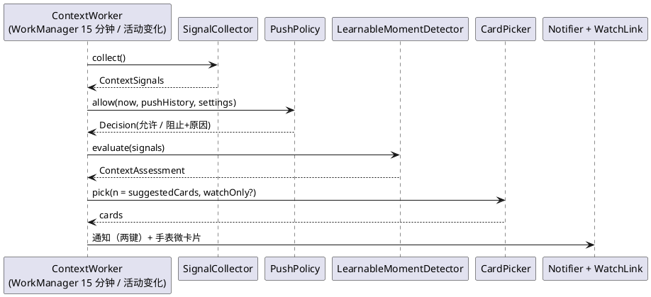
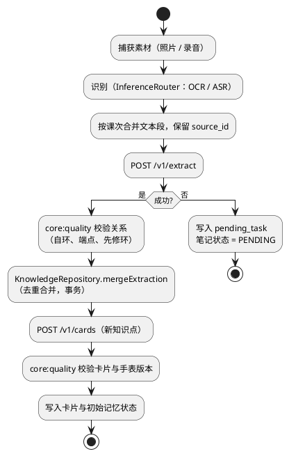

# 06 核心算法详细设计

- 文档编号：LX-DES-06
- 版本：v0.1（待评审）
- 日期：2026-11-21
- 所属阶段：系统设计 2.6
- 上游：[01 总体架构](01-architecture.md)、[03 数据库](03-database.md)、[04 接口](04-api.md)

本文档给出四个核心算法的详细设计：情境推送决策（创新 I1）、课堂内容到卡片的流水线（创新 I2、I5）、端云协同路由（创新 I3）、卡片调度与出卡队列（核心交互）。
每节包括：输入输出、算法步骤（伪代码）、参数、边界条件、对应测试用例清单。测试用例编号 `TC-<模块>-<序号>` 在测试计划中引用。

---

## 1. 情境推送决策（context-engine，I1）

### 1.1 结构



`PushPolicy`（新增）负责「能不能打扰」，`LearnableMomentDetector`（已有）负责「适不适合学」，两者职责分离、分别测试。

### 1.2 PushPolicy：打扰预算与静音时段（FR-CTX-08、09）

```
输入：now，今日推送记录 history（按时间升序，含 outcome），settings
输出：Decision.Allow | Decision.Block(reasonCode, 中文原因)

1. if !settings.pushEnabled                         → Block(DISABLED, "已关闭推送")
2. for 段 in settings.quietHours（支持跨零点，如 22:30–07:30）:
       if now 落在段内                               → Block(QUIET_HOURS, "静音时段 22:30–07:30")
3. if history.size >= settings.dailyLimit           → Block(BUDGET_DAILY, "今日已推送 3 次")
4. last = history.lastOrNull()
   if last != null && now - last.sentAt < settings.minInterval
                                                    → Block(BUDGET_INTERVAL, "距上次推送 47 分钟")
5. 末两条 outcome 均为 IGNORED/DISMISSED            → Block(IGNORED_TWICE, "连续忽略 2 次，今天不再打扰")
6. → Allow
```

| 参数 | 默认 | 来源 |
| --- | --- | --- |
| dailyLimit | 3 | 问卷结论，FR-CTX-08 |
| minInterval | 120 分钟 | FR-CTX-08 |
| quietHours | 22:30–07:30、12:00–13:30 | 问卷结论，FR-CTX-09 |

与 `LearnableMomentDetector` 现有参数的关系：现有 `cooldownMinutes = 30` 与 `quietHours = 23..6` 将移除，统一由 `PushPolicy` 管理，避免两处规则不一致。

测试用例：

| 编号 | 场景 | 期望 |
| --- | --- | --- |
| TC-CTX-01 | 23:10，跨零点静音段 | Block(QUIET_HOURS) |
| TC-CTX-02 | 07:30 整（静音段结束边界） | Allow（区间左闭右开） |
| TC-CTX-03 | 12:30 午休 | Block(QUIET_HOURS) |
| TC-CTX-04 | 今日已推 3 次 | Block(BUDGET_DAILY) |
| TC-CTX-05 | 距上次 119 分钟 / 120 分钟 | Block / Allow |
| TC-CTX-06 | 最近两次均 IGNORED | Block(IGNORED_TWICE) |
| TC-CTX-07 | 最近一次 IGNORED、上一次 ANSWERED | Allow |
| TC-CTX-08 | 用户自定义静音段为空 | 不因静音阻止 |
| TC-CTX-09 | 模拟一整天每 15 分钟评估一次的信号回放 | 推送次数 ≤ 3，且都不在静音段 |

### 1.3 LearnableMomentDetector 调整

保留现有三步（硬性阻止 → 证据打分 → 负荷评估），调整如下：

- 硬性阻止只保留与身体状态有关的：上课、乘车、跑步、系统免打扰。
- 新增证据「接下来 ≥ 20 分钟没有课」+0.1（来自课表），「距下节课 < 5 分钟」−0.3。
- 无手表时 `heartRateBpm = null`，负荷按活动状态估计（已支持）。
- 输出增加 `reasonSummary`：取权重绝对值最大的两条正向依据，拼成 ≤ 10 字的短句（如「排队中·无课」），供手表顶部显示（FR-WEAR-02）。

测试用例 TC-CTX-10 至 TC-CTX-16：在已有 13 个单测基础上，补充课表证据、短句生成（长度 ≤ 10 字）、无心率退化、上课阻止优先级。

### 1.4 CardPicker

```
输入：n（1–3），watchOnly（是否推手表）
1. 候选 = 今日到期卡片中 status=ACTIVE 的卡
2. if watchOnly: 候选 = 候选.filter { watchPrompt != null }
3. 按可提取性从低到高排序（最需要复习的先推）
4. 排除今日已推送过的卡
5. 取前 n 张；不足时返回已有的，0 张则本次不推送
```

---

## 2. 课堂内容到卡片流水线（I2、I5）

### 2.1 流程



### 2.2 知识点去重合并（FR-KG-02）

```
输入：课程 c，抽取结果 E（points, edges），已有知识点 K(c)
1. for p in E.points:
     key = normalize(p.title)          // 去空白与标点、全角转半角、英文小写、同义词表映射
     if K 中存在 norm_title == key      → 命中，match = 该节点
     else:
        v = embed(p.title + "：" + p.summary)       // 端侧 EMBEDDING 任务
        best = argmax_{k∈K} cos(v, k.embedding)
        if cos(v, best) >= 0.88         → match = best
        else                            → 新建节点（id 新生成 UUID）
     idMap[p.id] = match.id 或新 id
     追加 kp_source(match/新节点, note)
2. for e in E.edges: 用 idMap 改写端点后交给关系校验（2.3）
3. 全部在一个数据库事务内完成
```

| 参数 | 值 | 依据 |
| --- | --- | --- |
| 相似度阈值 | 0.88 | 初值，I4 用 30 对人工标注样本调参，记录到 ADR |
| 向量模型 | 端侧小型中文句向量模型（384 维），ADR 0008 待选 | 去重只在端侧计算，不上传 |

### 2.3 关系校验（core:quality，FR-KG-03）

```
1. 丢弃 from == to、端点不存在、relation 非法的边
2. 同一 (from, to, relation) 重复 → 保留 confidence 最大者
3. 先修环检测：把已有 PREREQUISITE 边与新边合并成有向图，
   按 confidence 从高到低逐条加入；若加入后出现环（DFS 判环），丢弃该边并记录冲突日志
```

复杂度：每课 ≤ 300 节点，边 ≤ 1,000，逐条 DFS 可接受（≤ 10 ms）。

### 2.4 卡片校验（core:quality，FR-REV-10、FR-WEAR-08）

规则与网关 `/v1/cards` 相同（见 04-api.md 1.5 节），实现为 `List<Rule>`，每条规则返回 `Violation(code, severity)`：`severity = DROP` 丢弃卡片，`STRIP_WATCH` 只清空手表版本。字数按 Unicode 码点计数，中英文同等计 1。

测试用例：

| 编号 | 场景 | 期望 |
| --- | --- | --- |
| TC-KG-01 | 「泰勒展开」与「泰勒 展开」 | 归一化命中，合并 |
| TC-KG-02 | 「泰勒公式」与「泰勒展开」，向量相似度 0.91 | 合并 |
| TC-KG-03 | 相似度 0.87 | 新建节点 |
| TC-KG-04 | 自环边、端点不存在的边 | 丢弃 |
| TC-KG-05 | A→B、B→C、C→A（置信度 0.9、0.8、0.5） | 丢弃 C→A |
| TC-KG-06 | 合并中途异常 | 事务回滚，无半写数据 |
| TC-QA-01 | 单选题只有 1 个选项 / 2 个正确项 | DROP |
| TC-QA-02 | 挖空题没有或有两个 `{{c1::}}` | DROP |
| TC-QA-03 | watch_prompt 21 字 | STRIP_WATCH，卡片保留 |
| TC-QA-04 | watch_answer 恰好 12 字 | 通过 |
| TC-QA-05 | 中英文混排计数 | 按码点计数正确 |

---

## 3. 端云协同路由（core:ai，I3）

### 3.1 现状与扩展

`DefaultRoutingPolicy` 已实现 6 级规则（见代码 KDoc），本阶段扩展：

1. **任务类型补全**：新增 `OCR`（端侧优先、可上云）、`ASR`（只在端侧，音频不出手机，NFR-PRIV-01）、`EXTRACT` 与 `CARD_GEN`（只在云端）。
2. **用户隐私设置**：`DeviceState` 增加 `allowCloudFor: Set<AiTaskType>`；任务含个人数据且用户未允许上传时，即使端侧失败也不回退到云端（FR-SET-01）。
3. **质量回退**：OCR 端侧结果平均置信度 < 0.6 且允许上传图片 → 回退云端（FR-NOTE-01 异常流程）。
4. **执行记录**：`InferenceRouter` 每次执行写 `ai_execution`（位置、原因、耗时、结果），界面展示（FR-AI-04）。
5. **离线队列**：`Unavailable` 的可延迟任务（EXTRACT、CARD_GEN）返回 `Deferred(taskId)`，由 `core:data` 入 `pending_task`，WorkManager 在联网约束下重试，退避 1、2、4、8、16 分钟，5 次后标记失败（FR-AI-05）。

### 3.2 决策表（摘要）

| 任务 | 有网 | 无网 | 含隐私且未授权上传 | 低电量 / 发热 |
| --- | --- | --- | --- | --- |
| OCR | 端侧，置信度低回退云端 | 端侧 | 端侧，不回退 | 端侧（轻任务） |
| ASR | 端侧 | 端侧 | 端侧 | 端侧，录音结束后再转写 |
| EMBEDDING | 端侧 | 端侧 | 端侧 | 端侧 |
| EXTRACT / CARD_GEN | 云端 | 延迟入队 | 不执行，提示用户开启上传 | 云端 |
| CHAT | 云端，端侧备用（复赛） | 端侧（复赛）/ 不可用 | 端侧 | 云端 |

测试用例 TC-AI-01 至 TC-AI-12：决策表每一格至少一个用例；`InferenceRouter` 主路线失败切换备用（已有）、两侧失败、延迟入队、执行记录字段完整。

---

## 4. 卡片调度与出卡队列（core:review）

### 4.1 FSRS 调度（已有）

`FsrsScheduler.schedule(state, rating, now)` 已实现 FSRS 公式并有测试。本阶段新增：

- `predictIntervals(state, now): Map<Rating, Duration>`：对四档评分各模拟一次 `schedule`，返回下次间隔，用于三键上的「10分 / 1天 / 4天」（FR-REV-07）。
- `targetRetention` 由课程决定（考前模式 0.95，FR-REV-16）。

### 4.2 今日队列（FR-REV-03、14、15）

```
输入：now，cap 复习上限，newPerDay，groupSize（默认 6）
1. due   = 到期复习卡（due_at <= 今日结束），按 due_at 升序
2. fresh = 新卡（state=NEW），按创建时间，取 newPerDay - 今日已学新卡数
3. if due.size > 50:                               // 积压保护（FR-REV-15）
       due = graphAwareSort(due)
4. queue = interleave(due.take(cap), fresh)         // 每 4 张复习插 1 张新卡
5. 按 groupSize 切分为组

graphAwareSort(cards):
  按知识点在先修图中的拓扑层级升序（前置在前），同层按可提取性升序

组内回炉（FR-REV-14）：
  本组评分为 AGAIN 的卡在组末再出现一次；第二次作答写 review_log(counted=0)，不再调用 schedule
前置失败顺延：
  若卡片 X 的知识点是 Y 的前置且 X 本组评 AGAIN，则 Y 的卡移到下一组
```

### 4.3 撤销（FR-REV-04）

撤销最近一次自评：用 `review_log.prev_state_json` 恢复 `memory_state`，删除该日志行；同一事务完成。只允许撤销本次会话内最近一张。

### 4.4 客观题自动判分（FR-REV-13）

判断、单选：答对 → GOOD，答错 → AGAIN；答对后 3 秒内点「其实是蒙的」→ 改为 HARD（撤销后重记）。手表只产生 AGAIN / GOOD。

测试用例：

| 编号 | 场景 | 期望 |
| --- | --- | --- |
| TC-REV-01 | predictIntervals 四档单调递增 | AGAIN < HARD < GOOD < EASY |
| TC-REV-02 | 上限 20、到期 35 | 队列复习卡 20 张 |
| TC-REV-03 | 新卡与复习卡交错 | 每 4 张复习后 1 张新卡 |
| TC-REV-04 | 积压 60 张，含先修关系 | 前置知识点的卡在前 |
| TC-REV-05 | 组内 AGAIN 回炉 | 组末再出现，第二次 counted=0 |
| TC-REV-06 | 前置卡 AGAIN | 依赖它的卡顺延到下一组 |
| TC-REV-07 | 撤销 | 记忆状态恢复，日志删除 |
| TC-REV-08 | 考前模式保持率 0.95 | 间隔短于 0.90 时 |
| TC-REV-09 | 手表回传 grade=3 重复两次（同 message_id） | 只写入一次 |
